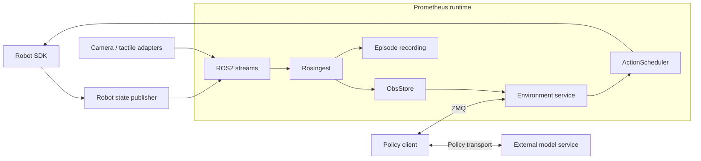

# Prometheus

**English** | [简体中文](README_zh.md)

**A modular framework for robot observations, action execution, and episode recording.**

Prometheus connects robot hardware and sensors to external policies through a shared runtime. It provides observation storage, action-chunk scheduling, robot and sensor adapters, recording, and a policy-facing environment interface. Model inference runs in a separate process and connects through a policy client.

**Phoenix Training RTC is an included integration example.** Its model, H32 training recipe, caches, and inference service live alongside the framework. They demonstrate how to connect a policy to Prometheus; their tensor shapes and model dependencies belong to that example.

## Framework overview

| Component | Responsibility |
| --- | --- |
| Hardware adapters | Connect to the robot SDK and sensors; expose state and action interfaces |
| Observation ingestion | Receive ROS2 streams as `StreamSample` values |
| `ObsStore` | Provide the latest observations, bounded history, and update barriers |
| `ActionScheduler` | Queue action chunks and send individual actions at the configured rate |
| Environment service | Manage sessions, observations, action submission, and episode termination |
| Recording | Persist robot state, actions, commands, images, timestamps, and configured tactile streams |
| Policy client SDK | Expose the environment through ZMQ without requiring policy code to import hardware adapters |



The scheduler owns per-step action dispatch. A policy client handles model requests and translates predictions into physical action chunks. With RTC, the client chooses the committed prefix while the scheduler continues execution. Action dimensions, units, chunk lengths, control rates, and queue settings must agree between the policy and the selected robot configuration.

`ObsStore.next()` waits for stream updates; cross-sensor timestamp alignment is handled separately by the consuming policy or data pipeline. The included hardware adapters cover ARX5, RealSense, and optional Xense sensors.

## Installation

The repository and source archive root are named `Prometheus`; the Python distribution is `Prometheus`, with runtime imports under `prometheus` and `prometheus_env`. The Phoenix example retains its `phoenix` and `wam` modules.

Use Python 3.10 or newer and run commands from the `Prometheus/` repository root. Install the transport and configuration dependencies first:

```bash
python3 -m venv .venv
source .venv/bin/activate
python -m pip install --upgrade pip
python -m pip install -r requirements-client.txt
python -m pip install -e . --no-deps

export PYTHONPATH="$PWD:$PWD/src${PYTHONPATH:+:$PYTHONPATH}"
export PYTHON="$(command -v python)"
```

The robot environment also needs ROS2 and the SDKs/drivers for its configured hardware. Model services may use separate environments. Install model and training dependencies only when using the [Phoenix example](docs/PHOENIX_RTC.md#getting-started).

| Dependency file | Used by |
| --- | --- |
| `requirements-client.txt` | Environment client and policy transport |
| `requirements-model.txt` | Phoenix model service |
| `requirements-training.txt` | Phoenix training and model dependencies |
| `requirements-data.txt` | Separate LeRobot v3 conversion environment |

## Configure and start a robot environment

Hardware templates are in `prometheus/configs/robot/` and `prometheus/configs/sensor/`. Workflow configurations in `prometheus/configs/run_env/` combine hardware, observations, scheduling, recording, and preview settings.

Start a local configuration from the included example and adjust it for the selected robot and policy:

```bash
cp prometheus/configs/run_env/phoenix.yaml \
   prometheus/configs/run_env/robot.local.yaml

# Edit robot.local.yaml before starting the environment.
python -m prometheus.workflows.run_env --config-name run_env/robot.local
```

Configure CAN interfaces, camera identities, gripper calibration, ROS2 settings, observation keys, and the ZMQ endpoint. Set `env.action_hz`, `env.max_chunk_horizon`, `env.policy_low_watermark`, and `env.fixed_chunk_switch` for the policy's execution contract. The copied configuration contains Phoenix example values that should be reviewed for a different policy.

The environment's `env.dry_run=true` setting skips the final SDK action send while still initializing hardware. Set `env.dry_run=false` when physical action publication is intended.

## Connect a policy

Use [prometheus_env/client.py](prometheus_env/client.py) to connect a policy process to the environment:

| Method | Purpose |
| --- | --- |
| `observe(obs_keys=...)` | Read current observations without starting control or submitting actions |
| `reset(expect=..., obs_keys=...)` | Start a session and check the requested action/execution contract |
| `step(actions, obs_keys=...)` | Submit a float32 action chunk and receive observations and episode status |
| `prepare_terminal(reason=...)` | Prepare to finish a session |
| `terminal(...)` | Accept, discard, and annotate an episode outcome |
| `close()` | Close the session and transport |

The policy adapter selects observation keys, applies its model's preprocessing and normalization, requests predictions, and converts them to the robot's physical action representation. The environment receives action chunks; model-specific tensors stay in the policy integration.

For another model, implement its client/transport conversion and configure the observation/action contract. For another robot, implement the [Robot protocol](prometheus/hardware/robot.py), add its Hydra configuration, and provide the corresponding observation and recording mappings. The [Phoenix client](phoenix/client.py) and [policy adapter](phoenix/protocol.py) illustrate model-side integration.

## Record episodes

Recording is configured independently of the model. Enable it when starting the environment:

```bash
python -m prometheus.workflows.run_env --config-name run_env/robot.local \
  recording.enabled=true recording.root=./data/recordings
```

The [episode layout](prometheus/data/layout.py) defines file names and timestamp units; [EpisodeWriter](prometheus/data/writer.py) persists the configured streams. Robot state, recorded actions, and commands have separate files. Image/tactile metadata and timestamps accompany their media streams. Available contents depend on the enabled hardware and recording settings.

Downstream consumers choose their training format. The Phoenix example includes **Prometheus recordings → LeRobot v3 → text/visual caches → Training RTC**; see the [data preparation guide](docs/DATA_PREPARATION.md). That conversion selects the RGB and joint14 features used by Phoenix.

## Example: Phoenix Training RTC

The included example connects an RGB/state-conditioned world–action model to Prometheus. It provides model training, an inference service, an RTC policy client, and a synchronous execution mode.

| Example setting | Default |
| --- | --- |
| Action chunk / sampled video / denoising | H32 / 9 frames / 10 inference steps |
| Physical state/actions | 14-dimensional absolute joints and grippers at 30 Hz |
| Training prefix | 100% uniform inclusive P0–P10; configurable |
| Execution profile | H32 / s16 / d8; configurable |

These are Phoenix example defaults. Select them together with the checkpoint, robot interface, and measured inference latency. The approximately 300 ms RTX 5090 client/service round-trip reference and the delay-budget guidance are documented in the [example guide](docs/PHOENIX_RTC.md#inference-latency-and-rtc-timing).

- [Phoenix example: setup, training, inference, and deployment](docs/PHOENIX_RTC.md)
- [Recording conversion and cache generation](docs/DATA_PREPARATION.md)
- [Training RTC inputs and checkpoint usage](docs/TRAINING_RTC.md)

`run.sh` provides shortcuts for the bundled example:

| Command | Purpose |
| --- | --- |
| `bash run.sh env rtc` / `env sync` | Prometheus environment with the Phoenix RTC/sync profile |
| `bash run.sh server` | Phoenix model service |
| `bash run.sh client` | Phoenix policy client |
| `bash run.sh data <stage>` | Phoenix conversion, manifest, and cache stages |
| `bash run.sh train` | Phoenix Training RTC and resume |
| `bash run.sh prepare` | Export a Phoenix model definition |

## Repository structure

| Directory | Contents |
| --- | --- |
| `prometheus/core/` | Shared stream, action, and metadata types |
| `prometheus/hardware/` | Robot SDK adapters, sensors, and ROS2 ingestion/publication |
| `prometheus/runtime/` | Observation storage, action scheduling, sinks, and preview |
| `prometheus/transport/` | Environment transport |
| `prometheus/recording/`, `prometheus/data/` | Episode capture, persistence, layout, and reading |
| `prometheus/workflows/`, `prometheus/configs/` | Environment orchestration and hardware/workflow configuration |
| `prometheus_env/` | Policy-facing environment client and WebSocket transport |
| `phoenix/`, `phoenix/data/` | Phoenix example: policy integration, training, and data preparation |
| `src/wam/` | Model, codecs, and joint sampling used by the Phoenix example |
| `configs/`, `scripts/` | Phoenix example configurations and training launcher |
| `docs/` | Architecture and usage guides |

## License

The Prometheus runtime and transport packages are released under [MIT](LICENSES/Prometheus-MIT.txt). Phoenix integration code uses the repository's [MIT License](LICENSE). Included third-party components retain the terms listed in [NOTICE](NOTICE) and [LICENSES](LICENSES/). Weights, datasets, hardware drivers, and SDK binaries are external resources with their own licenses.
