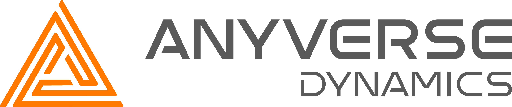
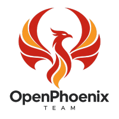
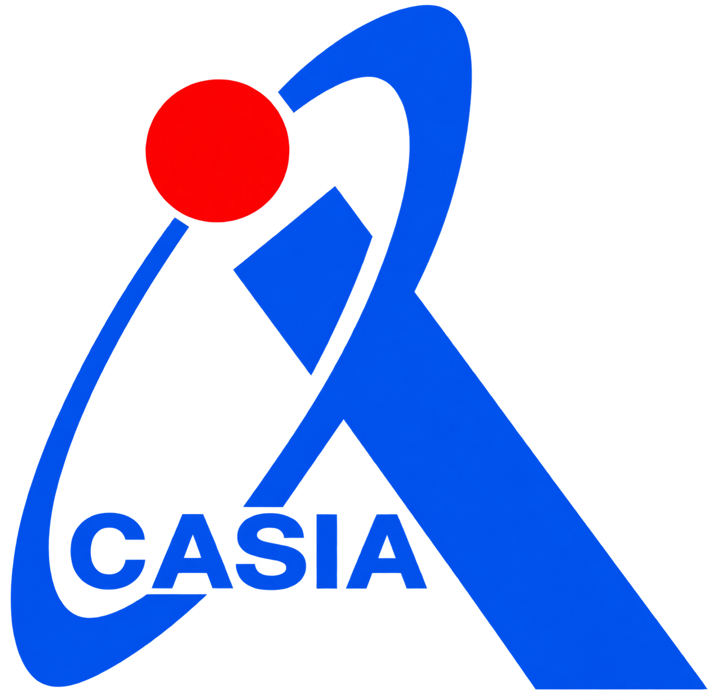
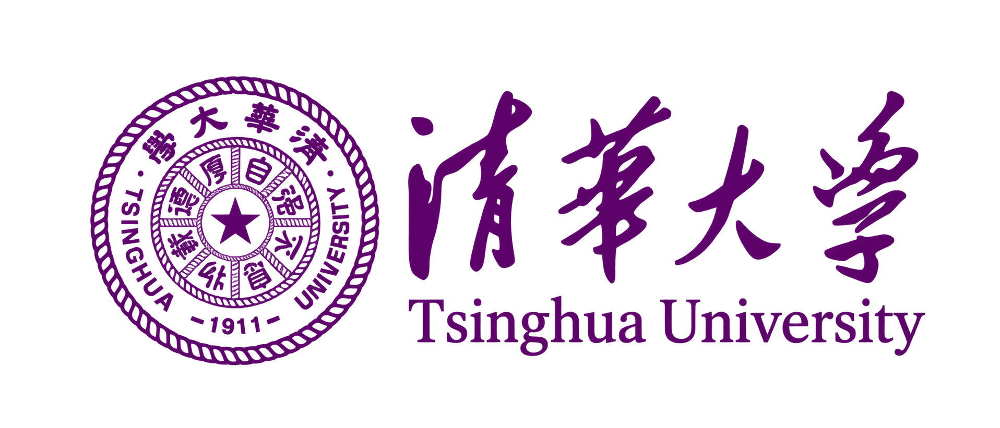
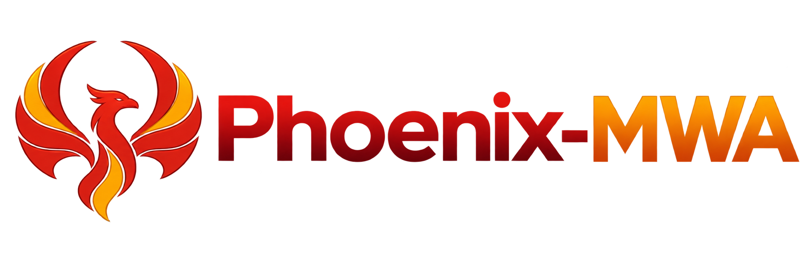
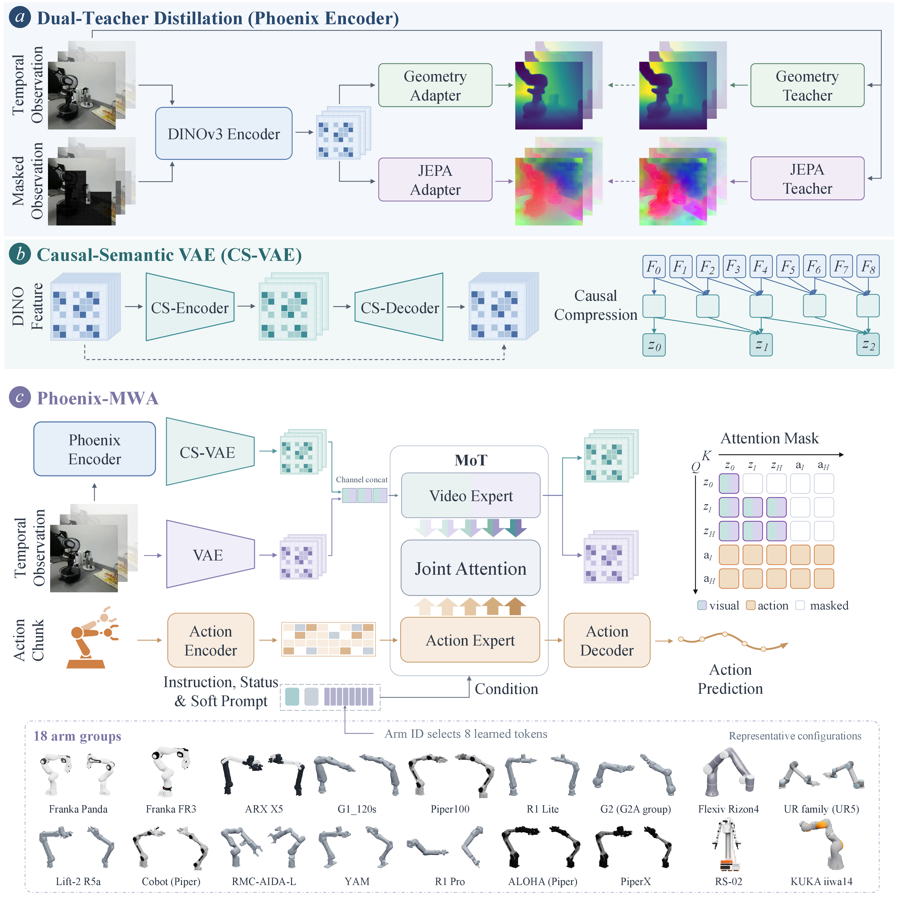

<p align="center">
  <a href="https://anyverse.com/"></a>&emsp;
  <a href="https://github.com/OpenPhoenix-Team">&nbsp;</a>&emsp;
  &emsp;
  &emsp;
  &emsp;
  
</p>

<p align="center">
  
</p>

<p align="center"><strong>Learning Generalizable World–Action Models<br>with Structural and Semantic Representations</strong></p>

<p align="center">
  <a href="https://openphoenix-team.github.io/Phoenix-pages/"></a>
  <a href="https://huggingface.co/collections/OpenPhoenix/phoenix-mwa"></a>
</p>

<p align="center">
  <a href="#overview">Overview</a> ·
  <a href="#getting-started">Getting Started</a> ·
  <a href="docs/TRAINING.md">Training</a> ·
  <a href="docs/RESOURCES.md">Resources</a>
</p>

This is the **main branch of Phoenix-MWA**, providing the **world–action pretraining code**. Other components are organized into dedicated branches:

- **Post-training & benchmark evaluation:** See the [post-train branch](https://github.com/OpenPhoenix-Team/Phoenix-MWA/tree/post-train).
- **Encoder pretraining (dual-teacher distillation & CS-VAE training):** See the `encoder` branch *(coming soon)*.
- **Data processing pipeline:** See the `data` branch *(coming soon)*.
- **Real-world RTC training & asynchronous inference deployment:** See the `rtc` branch *(coming soon)*.

## Overview



Phoenix-MWA is a world–action foundation model for generalizable robotic
manipulation. It combines appearance information from WanVAE with geometric and
semantic features from the Phoenix Encoder and Causal-Semantic VAE (CS-VAE).
Dual-teacher distillation brings geometric and temporal knowledge into the
Phoenix Encoder, while CS-VAE compresses its features into a compact, causal
visual representation.

This repository provides the pretraining implementation of Phoenix-MWA.
Conditioned on multi-view observations, language instructions, robot states, and
embodiment-specific prompts, video and action experts interact through a Mixture
of Transformers (MoT) to jointly predict future visual states and actions.
Pretraining across diverse robot embodiments connects learning environmental
dynamics with learning manipulation behavior, providing a shared foundation for
downstream tasks.

## Repository Layout

| Directory | Contents |
| --- | --- |
| `src/wam/` | Model, frozen visual codecs, datasets and training runtime |
| `configs/phoenix_pretrain.yaml` | Final pretraining recipe |
| `configs/pretrain/` | Dataset and action-coordinate contracts |
| `configs/embodiment_registry/` | Arm-group identities and prompt slots |
| `scripts/` | Training and distributed launch settings |
| `resources/` | Local initialization weights, data manifests and text caches; Git-ignored |
| `tools/` | Dataset and multi-view preparation |
| `docs/` | Training guide and resource layout |

## Getting Started

Use Python 3.10 with a compatible NVIDIA CUDA environment. The project pins
PyTorch 2.7.1 and torchvision 0.22.1; install the matching accelerator build
before resolving the project dependencies. The training environment uses
PyTorch 2.7.1+cu128.

Run from the Phoenix repository root:

```bash
conda create -n phoenix-pretrain python=3.10 -y
conda activate phoenix-pretrain
# Install the CUDA-compatible PyTorch 2.7.1 / torchvision 0.22.1 pair first.
python -m pip install -e '.[train,logging]'
python -m pip check
export PYTHON="$(command -v python)"
export PYTHONPATH="$PWD/src:$PWD"
```

The `train` extra installs DeepSpeed, and `logging` installs W&B.
Simulator packages are not required.

## Prepare Data and Weights
Prepare the complete `resources/` package before launching. It contains the Wan
DiT initialization, WanVAE, Phoenix Encoder, CS-VAE, dataset manifests and
precomputed text contexts. **A Git clone alone does not include these resources.**
Resource storage requirements depend on the selected data and text caches. Raw videos and
numeric trajectories remain on external shared storage at the indexed dataset
paths.

| Relative location | Contents |
| --- | --- |
| `resources/weights/Wan-AI/Wan2.2-TI2V-5B/` | Three pretrained video DiT shards |
| `resources/weights/DiffSynth-Studio/Wan-Series-Converted-Safetensors/` | Wan2.2-VAE |
| `resources/weights/phoenix_encoder/` | Phoenix Encoder, DINO110k EMA checkpoint |
| `resources/weights/csvae/csvae.pt` | CS-VAE format v2 checkpoint at step 150,000 |
| `resources/data_manifests/` | Dataset indexes, normalization, view plans and RGB selections |
| `resources/text_cache/` | Selected precomputed UMT5 contexts |
| `resources/MANIFEST.json` | Optional resource inventory |
| `PHOENIX_RESOURCE_BINDINGS` | External deployment bindings for local resources |

See [resource preparation and layout](docs/RESOURCES.md) for the exact
layout and transfer requirements. Training runs offline and does not download
missing files. A final trained policy, previous optimizer state and UMT5 model
weights are not required for fresh training with the supplied text caches.

## Training

Use `scripts/pretrain.sh` for fresh training or same-recipe full-state resume.

| Setting | Final recipe |
| --- | --- |
| Distributed topology | 28 nodes × 8 GPUs = 224 GPUs |
| Batch size | 20 per GPU; accumulation 1; global batch 4,480 |
| Precision and optimizer sharding | BF16; DeepSpeed ZeRO-1; communication overlap disabled |
| Training duration | 256,013 optimizer updates |
| Learning rate | 1e-4 → 1e-6; cosine decay after 10,000 warmup updates |
| Weight decay / gradient clipping | 0.01 / 1.0 |
| Save / validation interval | 5,000 updates; final weights and full state also saved |
| Seed | 42 |

For fresh training, run the following **once on every allocated node**, with the
same `RUN_ID` and `MASTER_ADDR`, and a distinct `NODE_RANK` from 0 to 27:

```bash
export PYTHON="$(command -v python)"
export NNODES=28 NPROC_PER_NODE=8
export NODE_RANK="${NODE_RANK:?Set this node rank from 0 to 27}"
export MASTER_ADDR="${MASTER_ADDR:?Set the rank-0 address}"
export MASTER_PORT=24319 CUDA_VISIBLE_DEVICES=0,1,2,3,4,5,6,7
export RUN_ID=phoenix_pretrain_001
unset RESUME_STATE
bash scripts/pretrain.sh
```

Choose a new run name for each launch. The launcher enforces the formal
224-GPU topology. W&B is disabled by default. See
[training and resume commands](docs/TRAINING.md).

## Compatibility and Acknowledgements

Use matching encoder architectures, action/state conventions, camera ordering
and train-only normalization. Full-state resume also checks topology, sampler
progress, optimizer/scheduler files and the training recipe. Runtime loading does
not recompute source or checkpoint file hashes. Dataset IDs and deterministic
sampling hashes remain part of the data protocol; they are not file verification.
See [resource compatibility](docs/RESOURCES.md#compatibility).

Phoenix builds on FastWAM, Wan, StarVLA, DINOv3 and LeRobot.
Source attribution is retained in [NOTICE](NOTICE), [LICENSE](LICENSE),
[`LICENSES/`](LICENSES/) and the bundled vendor tree. Model weights and datasets
remain subject to their respective licenses.

## Contact

Welcome to join us to share experimental results, ask questions, and exchange different viewpoints:

<p align="center">
  
</p>
