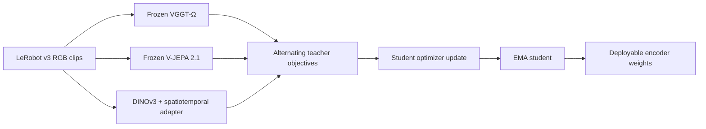

# Phoenix Encoder

**English** | [简体中文](README_zh.md)

**Multi-teacher visual encoder pretraining for RGB video.**

This repository contains a DINOv3-L/16 student with a shared spatiotemporal adapter, frozen VGGT-Ω and V-JEPA 2.1 teachers, LeRobot v3 video sampling, and an Accelerate training loop. The workflow trains and exports a visual encoder that downstream models can load independently of the teachers.

Encoder pretraining is the focus of this guide. CS-VAE compression and Phoenix world–action modeling are downstream consumers with their own training and data contracts.

## Architecture



The default student uses an eight-block adapter with spatial and temporal attention. Training alternates geometry and temporal objectives per optimizer update; all accumulated microbatches in one update use the same teacher. EMA tracks the deployment student. Teacher networks and training-only objective heads remain outside the exported encoder.

| Contract | Default |
| --- | --- |
| RGB input | `[B,T,3,256,256]`, floating values in `[0,1]` |
| Clip lengths | 4, 8, 12, or 16 frames |
| Sampling stride | 1 or 2 |
| Student output | `[B,T,256,1024]` patch features |
| Adapter | 8 blocks, 16 heads, 16 register tokens |
| Training | BF16, AdamW, warmup and cosine schedule |
| EMA momentum | 0.9999 |

These values describe the included encoder recipe. A downstream policy chooses its own action representation, video window, and inference schedule.

## Installation

Use Python 3.10 and prepare an accelerator-compatible PyTorch environment. Run commands from the repository root:

```bash
python3 -m venv .venv
source .venv/bin/activate
python -m pip install --upgrade pip
python -m pip install -e .
export PYTHONPATH="$PWD/src:$PWD${PYTHONPATH:+:$PYTHONPATH}"
```

Dependencies are declared in [pyproject.toml](pyproject.toml). The Python distribution retains the name `phoenix-mwa`; encoder code is imported from `wam`. On platforms that provide a vendor PyTorch build, preserve that build and prepare the remaining declared dependencies separately. Optional experiment tracking is available with `pip install -e '.[logging]'`.

## Resources and data

Provide teacher source checkouts, teacher weights, and LeRobot v3 datasets through external paths:

```bash
export PHOENIX_VGGT_SOURCE="$PWD/resources/vggt-omega"
export PHOENIX_VJEPA_SOURCE="$PWD/resources/vjepa2"
export PHOENIX_VGGT_CHECKPOINT="$PWD/checkpoints/vggt_omega_1b_512.pt"
export PHOENIX_VJEPA_CHECKPOINT="$PWD/checkpoints/vjepa2_1_vitl_dist_vitG_384.pt"
export PHOENIX_EGO_DATA="$PWD/data/ego_example"
export PHOENIX_ROBOT_DATA="$PWD/data/robot_example"
```

The two data entries are configurable examples. Set their paths, primary-camera `video_key`, sampling groups, and mixture weights in [dinov3_multiteacher.yaml](configs/encoder_pretrain/dinov3_multiteacher.yaml) to match the selected data. The loader uses native v3 episode metadata and video features, and samples auxiliary views as separate clip streams.

Teacher source revisions, input preprocessing, loss schedules, sampling, and output formats are described in the [encoder usage guide](docs/encoder_pretrain/README.md).

## Train

Inspect the configuration and resource metadata before starting optimization:

```bash
python -m wam.encoder_pretrain preflight \
  --config configs/encoder_pretrain/dinov3_multiteacher.yaml
```

Start training explicitly with a new run ID:

```bash
accelerate launch --num_processes 8 --mixed_precision bf16 \
  -m wam.encoder_pretrain train \
  --config configs/encoder_pretrain/dinov3_multiteacher.yaml \
  run_id=encoder_run_01
```

The recipe defaults to 160,000 optimizer updates, saving every 2,500 updates. Override settings with `key=value`, including `trainer.gradient_accumulation_steps`, `trainer.max_train_steps`, and the learning-rate groups. W&B is disabled by default; local metrics are written regardless of external tracking.

## Resume and exported weights

Outputs are written under `run_root_dir/run_id`:

```text
outputs/encoder_pretrain/encoder_run_01/
  config.full.yaml
  metrics.jsonl
  checkpoints/step_XXXXXXXX.pt
  ema_student_final.pt
```

Resume from a full checkpoint explicitly:

```bash
accelerate launch --num_processes 8 --mixed_precision bf16 \
  -m wam.encoder_pretrain train \
  --config configs/encoder_pretrain/dinov3_multiteacher.yaml \
  run_id=encoder_run_01 \
  trainer.resume_from=/path/to/training_checkpoint.pt
```

Full checkpoints restore student/EMA state, objective heads, optimizer, scheduler, sampler, and per-rank RNG. Resume requires matching model, data, world size, gradient accumulation, and training schedule. `ema_student_final.pt` contains the exported deployment student and its configuration; it is separate from a full resume checkpoint.

## Downstream integration

Training and inference share [wam.encoder.multi_teacher_distillation](src/wam/encoder/multi_teacher_distillation/). The exported encoder provides visual features to a consuming application. The included [OnlineDinov3DistilledEncoder](src/wam/model/modules/codecs/dino_stvae/online_dinov3_distilled_encoder.py) illustrates loading these weights in the Phoenix visual stack: select `checkpoint_state="student"` for the final export, or `checkpoint_state="ema_student"` for a full training checkpoint. Select `output_source="adapter"` for adapted features or `"backbone"` for DINO features.

Match the consuming model's preprocessing, feature source, temporal handling, and checkpoint configuration. CS-VAE weights and world–action model weights are configured separately; their existing acquisition commands are retained in [downstream resources](docs/DOWNSTREAM_RESOURCES.md).

For downstream policy use, configure an external checkpoint and its matching
[embodiment registry](docs/EMBODIMENT_REGISTRY.md). Bundled profile mappings are
examples; replace them with your own data profile IDs before training.

## Repository structure

| Location | Responsibility |
| --- | --- |
| `src/wam/encoder_pretrain/` | Training command, resource setup, data loader, trainer, resume, and export |
| `src/wam/encoder/multi_teacher_distillation/` | Student, adapter, teacher objectives, and masking |
| `src/wam/encoder/external_sources.py` | Teacher source contracts |
| `src/wam/third_party/dino_runtime/` | Bundled DINO runtime and licenses |
| `configs/encoder_pretrain/` | Encoder recipe and external resource configuration |
| `docs/encoder_pretrain/` | Detailed encoder usage |
| `src/wam/model/modules/codecs/dino_stvae/` | Downstream visual-stack integration |

## License

Project code uses the [MIT License](LICENSE). Included components retain the licenses in [NOTICE](NOTICE) and [LICENSES](LICENSES/), including the bundled DINOv3 license. External teacher sources, weights, and datasets retain their own terms.
