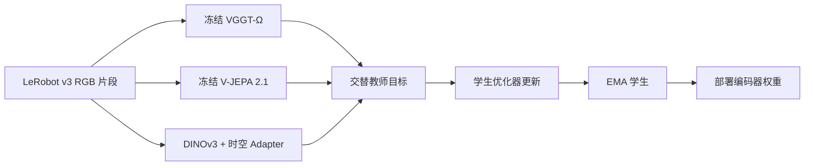

# Phoenix Encoder

[English](README.md) | **简体中文**

**面向 RGB 视频的多教师视觉编码器预训练。**

本仓库包含 DINOv3-L/16 学生编码器、共享时空 Adapter、冻结的 VGGT-Ω 与 V-JEPA 2.1 教师、LeRobot v3 视频采样和 Accelerate 训练循环，用于训练并导出可独立于教师网络使用的视觉编码器。

本指南以编码器预训练为主体。CS-VAE 压缩与 Phoenix 世界动作模型作为下游使用方，采用各自的训练与数据约定。

## 架构



默认学生包含 8 个 Adapter block，分别建模帧内空间关系和跨帧时序关系。几何与时序目标按优化器更新交替，同一次梯度累积的全部 microbatch 使用同一教师。EMA 跟踪用于部署的学生；导出编码器仅保留学生模块。

| 接口／配置 | 默认值 |
| --- | --- |
| RGB 输入 | `[B,T,3,256,256]`，数值范围 `[0,1]` |
| 片段长度 | 4、8、12 或 16 帧 |
| 采样步长 | 1 或 2 |
| 学生输出 | `[B,T,256,1024]` patch 特征 |
| Adapter | 8 个 block、16 个 head、16 个 register token |
| 训练 | BF16、AdamW、warmup 与余弦日程 |
| EMA momentum | 0.9999 |

以上参数属于随附编码器配置。下游策略自行确定动作表示、视频窗口和推理日程。

## 安装

使用 Python 3.10，并准备与计算设备兼容的 PyTorch 环境。以下命令从仓库根目录执行：

```bash
python3 -m venv .venv
source .venv/bin/activate
python -m pip install --upgrade pip
python -m pip install -e .
export PYTHONPATH="$PWD/src:$PWD${PYTHONPATH:+:$PYTHONPATH}"
```

依赖见 [pyproject.toml](pyproject.toml)。Python 发行包保留 `phoenix-mwa` 名称，编码器通过 `wam` 导入。平台提供专用 PyTorch 时，保留该构建并单独准备其余声明依赖。需要实验跟踪时，可安装 `pip install -e '.[logging]'`。

## 资源与数据

通过外部路径配置教师源码、教师权重和 LeRobot v3 数据：

```bash
export PHOENIX_VGGT_SOURCE="$PWD/resources/vggt-omega"
export PHOENIX_VJEPA_SOURCE="$PWD/resources/vjepa2"
export PHOENIX_VGGT_CHECKPOINT="$PWD/checkpoints/vggt_omega_1b_512.pt"
export PHOENIX_VJEPA_CHECKPOINT="$PWD/checkpoints/vjepa2_1_vitl_dist_vitG_384.pt"
export PHOENIX_EGO_DATA="$PWD/data/ego_example"
export PHOENIX_ROBOT_DATA="$PWD/data/robot_example"
```

两个数据项均为可配置示例。在 [dinov3_multiteacher.yaml](configs/encoder_pretrain/dinov3_multiteacher.yaml) 中设置数据路径、主相机 `video_key`、采样组和混合比例。读取器使用原生 v3 episode 元数据和视频字段，辅助相机作为独立片段流参与采样。

教师源码版本、预处理、损失日程、采样和输出格式见[编码器使用指南](docs/encoder_pretrain/README_zh.md)。

## 训练

先解析配置并检查资源元数据：

```bash
python -m wam.encoder_pretrain preflight \
  --config configs/encoder_pretrain/dinov3_multiteacher.yaml
```

使用新的 run ID 显式启动训练：

```bash
accelerate launch --num_processes 8 --mixed_precision bf16 \
  -m wam.encoder_pretrain train \
  --config configs/encoder_pretrain/dinov3_multiteacher.yaml \
  run_id=encoder_run_01
```

默认训练 160,000 次优化器更新，每 2,500 次保存一次。通过 `key=value` 覆盖 `trainer.gradient_accumulation_steps`、`trainer.max_train_steps` 和各学习率组。W&B 默认关闭，本地指标始终写入。

## 恢复与导出权重

输出位于 `run_root_dir/run_id`：

```text
outputs/encoder_pretrain/encoder_run_01/
  config.full.yaml
  metrics.jsonl
  checkpoints/step_XXXXXXXX.pt
  ema_student_final.pt
```

从完整 checkpoint 显式恢复：

```bash
accelerate launch --num_processes 8 --mixed_precision bf16 \
  -m wam.encoder_pretrain train \
  --config configs/encoder_pretrain/dinov3_multiteacher.yaml \
  run_id=encoder_run_01 \
  trainer.resume_from=/path/to/training_checkpoint.pt
```

完整 checkpoint 恢复学生、EMA、训练目标模块、优化器、调度器、采样器和各 rank RNG，要求模型、数据、world size、梯度累积和训练日程一致。`ema_student_final.pt` 保存部署学生及其配置，用途与完整训练恢复 checkpoint 分开。

## 下游接入

训练与推理共享 [wam.encoder.multi_teacher_distillation](src/wam/encoder/multi_teacher_distillation/)。导出编码器向下游应用提供视觉特征。随附的 [OnlineDinov3DistilledEncoder](src/wam/model/modules/codecs/dino_stvae/online_dinov3_distilled_encoder.py) 展示了 Phoenix 视觉链路的加载方式：最终导出使用 `checkpoint_state="student"`，完整训练 checkpoint 使用 `checkpoint_state="ema_student"`。`output_source="adapter"` 选择适配后特征，`"backbone"` 选择 DINO 特征。

使用时对齐下游模型的预处理、特征来源、时序处理和 checkpoint 配置。CS-VAE 与世界动作模型权重分别配置，原有获取命令保留在[下游资源说明](docs/DOWNSTREAM_RESOURCES.md)中。

下游策略使用外部权重及其匹配的[具身映射配置](docs/EMBODIMENT_REGISTRY.md)。仓库中的数据 profile 映射为示例，训练前需替换为自己的数据标识。

## 仓库结构

| 位置 | 职责 |
| --- | --- |
| `src/wam/encoder_pretrain/` | 训练入口、资源配置、数据读取、训练器、恢复和导出 |
| `src/wam/encoder/multi_teacher_distillation/` | 学生、Adapter、教师目标与 mask |
| `src/wam/encoder/external_sources.py` | 教师源码接口 |
| `src/wam/third_party/dino_runtime/` | DINO 运行时与许可证 |
| `configs/encoder_pretrain/` | 编码器训练及外部资源配置 |
| `docs/encoder_pretrain/` | 编码器详细使用指南 |
| `src/wam/model/modules/codecs/dino_stvae/` | 下游视觉链路接入 |

## 许可证

项目代码采用 [MIT License](LICENSE)。第三方组件保留 [NOTICE](NOTICE) 和 [LICENSES](LICENSES/) 中的许可，包括随附的 DINOv3 许可。外部教师源码、权重和数据集适用各自条款。
