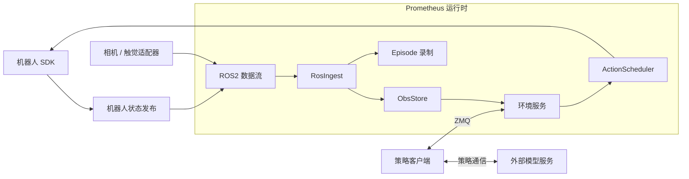

# Prometheus

[English](README.md) | **简体中文**

**面向机器人观测、动作执行与 episode 录制的模块化框架。**

Prometheus 通过统一运行时连接机器人硬件、传感器和外部策略，提供观测缓存、动作块调度、机器人与传感器适配、数据录制及面向策略的环境接口。模型推理由独立进程运行，通过策略客户端接入。

**Phoenix Training RTC 是仓库附带的一个集成示例。** 其模型、H32 训练配置、缓存和推理服务用于展示策略如何接入 Prometheus；相关张量形状与模型依赖属于该示例。

## 框架概览

| 组件 | 职责 |
| --- | --- |
| 硬件适配 | 连接机器人 SDK 与传感器，提供状态读取和动作接口 |
| 观测接入 | 将 ROS2 数据流转换为 `StreamSample` |
| `ObsStore` | 提供最新观测、有限历史与观测更新等待 |
| `ActionScheduler` | 管理动作块队列，按配置频率逐步发送动作 |
| 环境服务 | 管理会话、观测、动作提交与 episode 结束 |
| 数据录制 | 保存机器人状态、动作、命令、图像、时间戳及配置的触觉数据 |
| 策略客户端 SDK | 通过 ZMQ 暴露环境接口，策略侧无需导入硬件适配器 |



调度器负责逐步发送动作；策略客户端负责模型请求，并将预测转换为物理动作块。RTC 模式下，客户端选择已承诺执行的动作前缀，调度器继续执行队列。策略与机器人配置需要对齐动作维度、单位、动作块长度、控制频率和队列设置。

`ObsStore.next()` 等待各数据流更新，跨传感器的时间戳对齐由使用观测的策略或数据管线另外处理。仓库包含 ARX5、RealSense 及可选 Xense 传感器适配器。

## 安装

仓库目录与源码压缩包顶层目录统一为 `Prometheus`，Python 发行包名为 `Prometheus`；运行时导入路径为 `prometheus` 和 `prometheus_env`，Phoenix 示例保留 `phoenix`、`wam` 模块。

使用 Python 3.10 或更高版本，以下命令均从 `Prometheus/` 仓库根目录执行。先安装通信与配置依赖：

```bash
python3 -m venv .venv
source .venv/bin/activate
python -m pip install --upgrade pip
python -m pip install -r requirements-client.txt
python -m pip install -e . --no-deps

export PYTHONPATH="$PWD:$PWD/src${PYTHONPATH:+:$PYTHONPATH}"
export PYTHON="$(command -v python)"
```

机器人环境还需要 ROS2，以及所配置硬件的 SDK 与驱动。模型服务可以使用独立环境；运行 [Phoenix 示例](docs/PHOENIX_RTC_zh.md#快速开始) 时再安装相应模型与训练依赖。

| 依赖文件 | 使用范围 |
| --- | --- |
| `requirements-client.txt` | 环境客户端与策略通信 |
| `requirements-model.txt` | Phoenix 模型服务 |
| `requirements-training.txt` | Phoenix 训练与模型依赖 |
| `requirements-data.txt` | 独立的 LeRobot v3 转换环境 |

## 配置并启动机器人环境

硬件模板位于 `prometheus/configs/robot/` 和 `prometheus/configs/sensor/`。`prometheus/configs/run_env/` 下的工作流配置组合硬件、观测、调度、录制与预览设置。

从随附示例复制本地配置，并按所选机器人和策略修改：

```bash
cp prometheus/configs/run_env/phoenix.yaml \
   prometheus/configs/run_env/robot.local.yaml

# 编辑 robot.local.yaml 后再启动环境。
python -m prometheus.workflows.run_env --config-name run_env/robot.local
```

配置 CAN 接口、相机身份、夹爪标定、ROS2、观测键和 ZMQ 地址。按照策略执行约定设置 `env.action_hz`、`env.max_chunk_horizon`、`env.policy_low_watermark` 与 `env.fixed_chunk_switch`。复制的配置带有 Phoenix 示例参数，接入其他策略时应相应调整。

环境的 `env.dry_run=true` 会跳过最后的 SDK 动作发送，但仍初始化硬件；需要发布物理动作时设置 `env.dry_run=false`。

## 接入策略

策略进程通过 [prometheus_env/client.py](prometheus_env/client.py) 连接环境：

| 方法 | 用途 |
| --- | --- |
| `observe(obs_keys=...)` | 读取当前观测，不启动控制或提交动作 |
| `reset(expect=..., obs_keys=...)` | 启动会话并核对动作与执行约定 |
| `step(actions, obs_keys=...)` | 提交 float32 动作块，返回观测和 episode 状态 |
| `prepare_terminal(reason=...)` | 准备结束会话 |
| `terminal(...)` | 接受或丢弃 episode，并记录结果 |
| `close()` | 关闭会话与通信连接 |

策略适配层负责选择观测键、执行模型预处理与归一化、请求预测，并将结果转换为机器人的物理动作表示。环境接收动作块，模型内部张量由各自的策略集成代码处理。

接入其他模型时，实现其客户端与通信转换，并配置观测／动作约定。接入其他机器人时，实现 [Robot 协议](prometheus/hardware/robot.py)，补充 Hydra 配置和对应的观测／录制映射。[Phoenix 客户端](phoenix/client.py)和[策略适配器](phoenix/protocol.py)展示了模型侧的接入方式。

## 录制 episode

录制独立于模型配置，可在启动环境时启用：

```bash
python -m prometheus.workflows.run_env --config-name run_env/robot.local \
  recording.enabled=true recording.root=./data/recordings
```

[Episode 布局](prometheus/data/layout.py)定义文件命名和时间戳单位，[EpisodeWriter](prometheus/data/writer.py)负责持久化配置的数据流。机器人状态、记录动作和控制命令分别保存；图像与触觉媒体附带各自的元数据和时间戳。实际内容取决于启用的硬件与录制配置。

下游训练管线自行选择数据格式。Phoenix 示例附带 **Prometheus 录制 → LeRobot v3 → 文本／视觉缓存 → Training RTC** 链路，详见[数据准备指南](docs/DATA_PREPARATION.md)。该转换选取 Phoenix 使用的 RGB 和 joint14 特征。

## 示例：Phoenix Training RTC

该示例将 RGB／状态条件下的世界动作模型接入 Prometheus，包含模型训练、推理服务、RTC 策略客户端和同步执行模式。

| 示例配置 | 默认值 |
| --- | --- |
| 动作块／采样视频／去噪 | H32／9 帧／10 步推理去噪 |
| 物理状态与动作 | 14 维绝对关节和夹爪值，30 Hz |
| 训练前缀 | P0–P10（含两端）100% 均匀采样，可配置 |
| 执行配置 | H32 / s16 / d8，可配置 |

以上为 Phoenix 示例默认值，需结合 checkpoint、机器人接口及实际推理延迟选择。RTX 5090 客户端／模型服务完整往返约 300 ms 的参考说明，以及执行延迟预算，见[示例指南](docs/PHOENIX_RTC_zh.md#推理耗时与-rtc-时序)。

- [Phoenix 示例：安装、训练、推理与部署](docs/PHOENIX_RTC_zh.md)
- [录制数据转换与缓存生成](docs/DATA_PREPARATION.md)
- [Training RTC 输入与 checkpoint 使用](docs/TRAINING_RTC.md)

`run.sh` 为仓库附带示例提供快捷入口：

| 命令 | 功能 |
| --- | --- |
| `bash run.sh env rtc` / `env sync` | 使用 Phoenix RTC／同步配置启动 Prometheus 环境 |
| `bash run.sh server` | Phoenix 模型服务 |
| `bash run.sh client` | Phoenix 策略客户端 |
| `bash run.sh data <stage>` | Phoenix 数据转换、清单和缓存阶段 |
| `bash run.sh train` | Phoenix Training RTC 训练与恢复 |
| `bash run.sh prepare` | 导出 Phoenix 模型定义 |

## 仓库结构

| 目录 | 内容 |
| --- | --- |
| `prometheus/core/` | 共享的数据流、动作和元数据类型 |
| `prometheus/hardware/` | 机器人 SDK、传感器及 ROS2 接入／发布 |
| `prometheus/runtime/` | 观测缓存、动作调度、数据流转与预览 |
| `prometheus/transport/` | 环境通信 |
| `prometheus/recording/`、`prometheus/data/` | Episode 采集、持久化、布局与读取 |
| `prometheus/workflows/`、`prometheus/configs/` | 环境编排及硬件／工作流配置 |
| `prometheus_env/` | 面向策略的环境客户端与 WebSocket 通信 |
| `phoenix/`、`phoenix/data/` | Phoenix 示例：策略接入、训练和数据准备 |
| `src/wam/` | Phoenix 示例使用的模型、编解码器与联合采样 |
| `configs/`、`scripts/` | Phoenix 示例配置与训练启动脚本 |
| `docs/` | 架构与使用指南 |

## 许可证

Prometheus 运行时和通信代码按 [MIT](LICENSES/Prometheus-MIT.txt) 发布。Phoenix 集成代码使用仓库的 [MIT License](LICENSE)。第三方组件保留 [NOTICE](NOTICE) 和 [LICENSES](LICENSES/) 中列明的许可。模型权重、数据集、硬件驱动和 SDK 二进制均为外部资源，适用各自许可。
