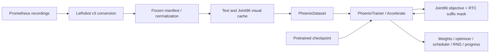
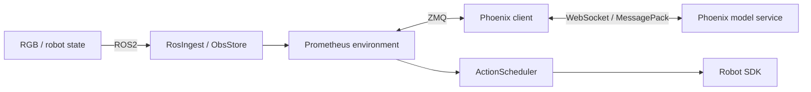

# Phoenix example architecture

The [Prometheus README](../README.md#framework-overview) describes the framework runtime and policy interface. This document describes the included Phoenix Training RTC integration and its execution profile.

## Training

`phoenix/` owns model integration, training, and the inference protocol. `src/wam/` owns the model, codecs, conditioning, and denoising operations. Training uses 32 actions and a 9-frame sampled video window. The 14 physical action/state dimensions occupy fixed slots in canonical80; unused slots are masked.

`phoenix/data/` owns recording alignment, native-v3 conversion, episode splits, normalization selection, and frozen encoder caches. Visual shards contain BF16 `[96,3,16,48]` windows with per-row checksums. `PhoenixDataset` joins the selected visual input with parquet state/action rows, language contexts, and masks. Selecting `visual_cache_index=null` uses RGB decoding and frozen encoding at training time. See the [data preparation guide](DATA_PREPARATION.md) for the full flow.

Training RTC replaces the action prefix with clean values, assigns timestep zero to prefix tokens, and supervises only valid suffix elements. It retains the joint video objective, attention semantics, and action scheduler weighting.

## Online execution

The model service returns complete action plans. `ActionScheduler` is the sole per-step action queue and publisher. The client owns replanning requests, prefix selection, and generation invalidation; the environment owns execution progress.

## H32 / s16 / d8

1. Generate the first 32-step plan A with an empty prefix, and submit `A[0:24]`.
2. With 8 steps remaining, request another plan using `A[16:24]` as `examples[0].action_prefix`.
3. Continue executing the committed 8-step prefix while inference runs.
4. Submit `B[8:24]`, the next 16 steps of the new plan. The scheduler switches after the previous queue and in-flight action complete.

The model clamps the normalized prefix before and after every denoising step and uses zero prefix timesteps. The service and client also check the physical prefix. Returned plans include model identity, request identity, and generation information to reject stale results.

The default training prefix range is 0–10; the default online delay is 8 steps. Both are configurable. The client requires the inference round trip plus one control tick to fit within `8/30` seconds before accepting subsequent RTC plans.

Sync mode uses the same model with an empty prefix and executes each complete 32-step chunk before replanning. Environment and client must use the same mode.

## Latency planning

Choose the runtime delay from the complete client/service round trip and desired timing margin. The client requires `roundtrip + 1/action_hz ≤ d/action_hz`; requests exceeding this bound are rejected. The trained prefix range must include `d`, and the environment low watermark must match it. Model configuration, training metadata, and service configuration must agree on the prefix range. See the [Phoenix example guide](PHOENIX_RTC.md#inference-latency-and-rtc-timing) for a hardware latency reference.

## Observation and hardware boundaries

`ObsStore.next()` waits for stream updates; it is not a cross-sensor timestamp synchronizer. Sensor publication, policy requests, queue dispatch, and SDK control loops are configured separately.

The environment initializes hardware resources even when `env.dry_run=true`; this setting suppresses final physical action publication. Configure CAN interfaces, camera identities, units, and gripper calibration for the target robot.
