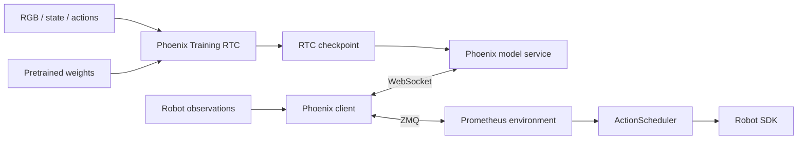

# Phoenix Training RTC example

[Prometheus overview](../README.md) | [简体中文](PHOENIX_RTC_zh.md)

Phoenix Training RTC is a policy integration example for the Prometheus robot runtime. This guide covers its model environment, data conversion, caches, training, inference, and deployment. Commands run from the repository root.

## Model and defaults

Phoenix combines 48-channel Wan video latents and 48-channel CS-VAE latents into a 96-channel visual representation. A video expert and an action expert jointly predict future video and actions. Robot state and actions use canonical80: external 14-dimensional joint/gripper values occupy their assigned slots, with the remaining dimensions masked.

Training RTC conditions on an action prefix. During training, prefix tokens contain clean actions at timestep zero, and action supervision applies only to the valid suffix. During inference, the prefix is fixed throughout denoising. Prometheus owns observations, committed actions, and the execution queue.



| Setting | Default |
| --- | --- |
| Action chunk | 32 |
| Video window | 9 frames: current frame and 8 future sampled frames |
| Joint inference denoising | 10 steps |
| Control frequency | 30 Hz |
| External state/actions | 14-dimensional absolute joint and gripper values |
| Internal state/actions | canonical80 |
| RTC prefix length | 0–10 by default; configurable |
| RTC execution | H32 / s16 / d8 by default; configurable |

## Getting started

Use Python 3.10 or newer with PyTorch, torchvision, and a runtime compatible with your accelerator. Run all commands from the repository root.

```bash
python -m venv .venv
source .venv/bin/activate
python -m pip install --upgrade pip

# Install the PyTorch / torchvision build for your device first.
python -m pip install -r requirements-training.txt
python -m pip install -e . --no-deps

export PYTHONPATH="$PWD:$PWD/src${PYTHONPATH:+:$PYTHONPATH}"
export PYTHON="$(command -v python)"
```

`requirements-training.txt` includes training and model-service dependencies. For a client-only environment, install `requirements-client.txt`. The robot workstation also needs ROS2, camera drivers, and the robot SDK.

`run.sh` provides a common entry point:

| Command | Purpose |
| --- | --- |
| `bash run.sh data <stage>` | Convert recordings, freeze manifests, and generate caches |
| `bash run.sh train` | Training RTC and training-state resume |
| `bash run.sh prepare` | Export a model definition from a saved configuration |
| `bash run.sh server` | Start the Phoenix model service |
| `bash run.sh client` | Read observations and request action predictions |
| `bash run.sh env` | Start the Prometheus robot environment |

Set `PYTHON` to select an interpreter. The model service and robot environment may use separate Python environments.

## Prepare data and weights

Configure model weights and data through external paths. A suggested layout is:

```text
checkpoints/
  phoenix_pretrained.pt       Training initialization weights
  phoenix_encoder.pt          Visual encoder weights
  phoenix_stvae.pt            CS-VAE weights
assets/
  phoenix_normalization.json State/action normalization statistics
  phoenix_text.pt             Language context for one inference instruction
data/
  manifest.json              Frozen window manifest
  text_index.json            Training language-cache index
runs/
  phoenix_training_rtc/      Training outputs
```

Set `DIFFSYNTH_MODEL_BASE_PATH` for common Wan components, preserving the directory layout required by the component loader. Set `PHOENIX_ENCODER_CHECKPOINT` and `PHOENIX_STVAE_CHECKPOINT` for the visual encoder and CS-VAE respectively.

### Data format

The complete preparation pipeline is included:

```text
Prometheus recordings → LeRobot v3 → frozen H32 manifest → text/visual cache → Training RTC
```

Use a separate conversion environment with `requirements-data.txt`. It uses the official LeRobot v3 writer; FFmpeg with H.264 encoding is required. Create an external JSON array with each episode's `path` and exact `instruction`, then run the stages explicitly:

```bash
python3 -m venv .venv-data
.venv-data/bin/python -m pip install -r requirements-data.txt
export DATA_PYTHON="$PWD/.venv-data/bin/python"
export PHOENIX_RECORDING_LIST="$PWD/data/recording_episodes.json"
PYTHON="$DATA_PYTHON" bash run.sh data convert

# Use the model environment for the remaining stages.
export PHOENIX_NORMALIZATION="$PWD/assets/phoenix_normalization.json"
bash run.sh data prepare
export PHOENIX_T5_CHECKPOINT="$PWD/checkpoints/models_t5_umt5-xxl-enc-bf16.pth"
export PHOENIX_T5_TOKENIZER="$PWD/checkpoints/google/umt5-xxl"
bash run.sh data cache-text
# Set the encoder, CS-VAE, and Wan component paths described below.
bash run.sh data cache-visual
```

Conversion supports both flat and nested Prometheus recording layouts. It aligns streams to 30 Hz and writes absolute joint14 labels using the **next observed state as a proxy action**, preserving physical values and units. Configure logical stream names, alignment tolerances, static trimming, and quality thresholds in [phoenix_data.yaml](../configs/phoenix_data.yaml). Existing native LeRobot v3 datasets can start at `data prepare`.

Preparation freezes episode membership and a held-out split, computes training-only statistics, and copies the explicitly selected normalization file unchanged. Fitting a new normalization requires an explicit option. Text and visual caches bind their manifest, frozen encoder weights, and preprocessing identities. Visual caching uses H32/9-frame windows and supports resumable shards and multiple workers. See the [complete preparation and cache guide](DATA_PREPARATION.md).

Training reads LeRobot-v3 parquet files and three corresponding RGB streams. A frozen manifest describes episodes, train/validation splits, task text, parquet row groups, and video time ranges. Source files are read-only.

A window spans 33 raw frames and 32 actions. Sampling video every 4 steps produces 9 frames in main-camera, left-wrist, right-wrist order. State comes from the first step; actions are absolute joint/gripper values. Padding masks exclude invalid positions at episode boundaries.

| Input | Shape / contents |
| --- | --- |
| RGB | `[B,3,3,9,256,256]`: batch, views, channels, time, height, width |
| Actions | `[B,32,80]`, mapped from physical 14-dimensional values |
| State | `[B,1,80]`, mapped from the current physical state |
| Language context | `[B,128,4096]` with a corresponding boolean mask |

Training and inference share a normalization file with schema `phoenix.joint14.normalization.v1`. It contains `gripper_unit` and 14-dimensional `mean` and positive `std` arrays for both `state` and `action`. The external order is six left-arm joints, left gripper, six right-arm joints, right gripper. Units must match the robot interface.

Convert existing statistics to the Phoenix file format without changing their numeric values or units:

```bash
python -m phoenix.training_inputs \
  --normalization assets/normalization.json \
  --output assets/phoenix_normalization.json \
  --gripper-unit m
```

The training language index uses `phoenix.text_index.v1` and records the window-manifest fingerprint, prompt template, and cache entries. Each language cache contains `context[128,4096]`, boolean `context_mask[128]`, and the corresponding `prompt`. See [training inputs](TRAINING_RTC.md) for the manifest and index fields.

### Configuration

| File | Contents |
| --- | --- |
| [phoenix_data.yaml](../configs/phoenix_data.yaml) | Recording conversion, manifests, normalization selection, text/visual caches |
| [phoenix_model.yaml](../configs/phoenix_model.yaml) | Joint96 architecture, visual components, and action expert |
| [phoenix_training_rtc.yaml](../configs/phoenix_training_rtc.yaml) | Training resources, optimizer, schedule, RTC, and resume settings |
| [phoenix.yaml](../configs/phoenix.yaml) | Inference resources, model identity, endpoints, and action execution |
| [run_env/phoenix.yaml](../prometheus/configs/run_env/phoenix.yaml) | Robot, cameras, observations, queue, and recording |

The model definition must match the selected checkpoint. You can export one from its saved configuration:

```bash
bash run.sh prepare \
  --source-config configs/saved_model.yaml \
  --output configs/phoenix_model.local.yaml
```

Point training's `model_definition` and inference's `model_config` to the exported file.

## Training

Set the initialization, data, and encoder paths. Compute SHA256 values from the selected files:

```bash
export PHOENIX_PRETRAINED_CHECKPOINT="$PWD/checkpoints/phoenix_pretrained.pt"
export PHOENIX_MANIFEST="$PWD/data/manifest.json"
export PHOENIX_NORMALIZATION="$PWD/assets/phoenix_normalization.json"
export PHOENIX_TEXT_INDEX="$PWD/data/text_index.json"
export PHOENIX_ENCODER_CHECKPOINT="$PWD/checkpoints/phoenix_encoder.pt"
export PHOENIX_STVAE_CHECKPOINT="$PWD/checkpoints/phoenix_stvae.pt"
export DIFFSYNTH_MODEL_BASE_PATH="$PWD/checkpoints"

export PHOENIX_PRETRAINED_SHA256="$(python -c 'from phoenix.config import sha256; import os; print(sha256(os.environ["PHOENIX_PRETRAINED_CHECKPOINT"]))')"
export PHOENIX_NORMALIZATION_SHA256="$(python -c 'from phoenix.config import sha256; import os; print(sha256(os.environ["PHOENIX_NORMALIZATION"]))')"
```

For data generated by the included pipeline, use these paths instead:

```bash
export PHOENIX_MANIFEST="$PWD/data/prepared/manifest.json"
export PHOENIX_NORMALIZATION="$PWD/data/prepared/normalization.json"
export PHOENIX_TEXT_INDEX="$PWD/data/text_cache/text_index.json"
export PHOENIX_VISUAL_CACHE_INDEX="$PWD/data/visual_cache/index.json"
# Recompute PHOENIX_NORMALIZATION_SHA256 after selecting normalization.
export PHOENIX_NORMALIZATION_SHA256="$(python -c 'from phoenix.config import sha256; import os; print(sha256(os.environ["PHOENIX_NORMALIZATION"]))')"
```

With a visual cache configured, training consumes BF16 latents directly. Set `data.visual_cache_index=null` to encode RGB online. Both modes require the same external frozen encoder files and model definition.

Training performs weights-only initialization and inherits the model architecture and embodiment soft prompts. The VAE and visual encoder stay frozen; MoT and state encoders follow the model's trainable-module boundaries. The default joint objective is:

```text
loss = 0.5 × VAE loss + 0.5 × STVAE loss + Action loss
```

Prefix lengths are sampled uniformly from the inclusive range P0–P10 (100% uniform sampling), without an additional forced P0 branch. Prefix timesteps are zero, and action loss supervises only valid suffix elements. Zero-prefix samples supervise the complete action chunk.

```bash
# Single process
bash run.sh train output_dir=runs/phoenix_training_rtc

# Single-node multi-GPU DDP
NPROC_PER_NODE=8 bash run.sh train \
  output_dir=runs/phoenix_training_rtc training.batch_size=1

# ZeRO-1 requires a compatible DeepSpeed installation
NPROC_PER_NODE=8 bash run.sh train \
  output_dir=runs/phoenix_training_rtc distributed.deepspeed_zero1=true
```

Defaults are AdamW, learning rate `5e-5`, minimum learning rate `5e-7`, weight decay `0.01`, 5% warmup, and cosine decay. Append `key=value` overrides, or use `--config configs/phoenix_training_rtc.local.yaml` to load custom settings.

For multiple nodes, set `NNODES`, `NPROC_PER_NODE`, `NODE_RANK`, `MASTER_ADDR`, and `MASTER_PORT`. All nodes share the output directory. Use a new directory for each independent run.

### Checkpoints and resume

```text
runs/phoenix_training_rtc/
  resolved_config.json
  training_contract.json
  normalization.json
  latest.json
  checkpoints/step_XXXXXX/
    weights.pt
    trainer_state.json
    ... optimizer / scheduler / RNG state ...
    COMPLETE.json
```

Use `weights.pt` for the model service and the complete directory for training resume. Resume restores optimizer, learning-rate scheduler, per-rank RNG, epoch, and consumed-batch progress. Training resources, schedule, and distributed topology must match.

```bash
NPROC_PER_NODE=8 bash run.sh train \
  output_dir=runs/phoenix_training_rtc \
  resume_state=/path/to/checkpoint_directory
```

## Inference

In `configs/phoenix.yaml`, set the completed Training RTC `checkpoint`, matching `model_config`, normalization, language context, and their SHA256 values. Set `embodiment` to the hardware identity in the checkpoint's registry.

The inference language file is a Torch dictionary containing the exact `instruction`, `context[1,L,4096]`, and boolean `mask[1,L]`. Use the same state/action ordering and normalization as training.

```bash
PYTHON="$MODEL_PYTHON" bash run.sh server --config configs/phoenix.yaml
```

The service accepts three RGB views, current state, and an action prefix, and returns a complete physical action tensor `[1,32,14]`. The 9-frame window is generated by the joint model; 10 steps refers to inference denoising. Online observations supply only current RGB and state.

### Recorded observations

An observation NPZ contains float32 `state[14]` and three uint8 HWC images: `base_0_rgb`, `left_wrist_0_rgb`, and `right_wrist_0_rgb`. RTC mode optionally accepts `action_prefix[d,14]` with `0≤d≤rtc.max_prefix_steps`; sync mode uses an empty prefix.

```bash
# RTC action prediction
PYTHON="$CLIENT_PYTHON" bash run.sh client --mode rtc \
  --input assets/observation.npz --output outputs/phoenix_actions.npz

# Synchronous action prediction
PYTHON="$CLIENT_PYTHON" bash run.sh client --mode sync \
  --input assets/observation_sync.npz --output outputs/phoenix_sync_actions.npz
```

Outputs contain 32 physical actions and inference information. Recorded-observation mode connects only to the model service.

### Inference latency and RTC timing

The reference RTX 5090 **end-to-end client/service round trip is approximately 300 ms**. For similar inference conditions, **0–10 prefix steps is a suggested Training RTC sampling range**. The repository uses this as a configurable default, not a fixed limit. Select the range for your own inference latency and scheduling conditions; a longer delay or greater latency variation may require a wider range.

At 30 Hz, 300 ms corresponds to about 9 control steps. Runtime delay `d` must cover the complete round trip, the client's one-tick reserve, and the desired timing margin. The default d8 template cannot accommodate a 300 ms round trip. A d10 profile only just covers 300 ms after the tick reserve, so allow for variation rather than treating d10 as a universal setting.

The prefix range is configured through `training_time_rtc.max_prefix_steps` in the training recipe and `action_dit_config.training_time_rtc.max_delay_steps` in the model definition. Set inference `rtc.max_prefix_steps` to the value recorded in the trained checkpoint. Choose `rtc.inference_delay=d` and environment `env.policy_low_watermark=d` together, with `d` inside the trained prefix range. Execution length `s` and delay `d` must satisfy `0<d<s` and `s+d≤32`. The default uses uniform sampling without an additional forced zero-prefix branch.

## Robot deployment

Configure CAN interfaces, camera serial numbers, gripper calibration, and ROS2 in `prometheus/configs/run_env/phoenix.yaml`. Set model-service and environment endpoints in `configs/phoenix.yaml`.

Start the model service, robot environment, and client as separate processes:

```bash
# Model device
PYTHON="$MODEL_PYTHON" bash run.sh server

# Robot workstation: environment process
PYTHON="$ROBOT_PYTHON" bash run.sh env rtc

# Robot workstation: policy client
PYTHON="$CLIENT_PYTHON" bash run.sh client --mode rtc --execute --chunks 3
```

The environment defaults to `env.dry_run=true` and still initializes hardware resources. Append `env.dry_run=false` to the environment command to publish physical actions. The client prompts before connecting to the environment.

Default RTC execution is H32 / s16 / d8. The first plan submits 24 actions. With 8 actions remaining, the client starts another prediction, using the 8 committed actions as its prefix, then submits 16 actions from the new suffix. `ActionScheduler` owns per-step publication and queue switching.

Sync mode uses the same model and executes all 32 actions before replanning. Select `sync` for both the environment and client:

```bash
PYTHON="$ROBOT_PYTHON" bash run.sh env sync
PYTHON="$CLIENT_PYTHON" bash run.sh client --mode sync --execute --chunks 3
```
