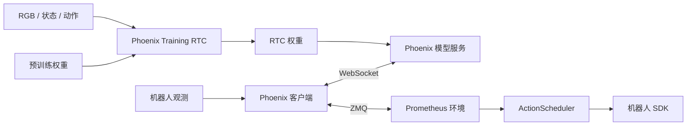

# Phoenix Training RTC 示例

[Prometheus 框架说明](../README_zh.md) | [English](PHOENIX_RTC.md)

Phoenix Training RTC 是 Prometheus 机器人运行框架中的一个策略接入示例。本指南说明其模型环境、数据转换、缓存、训练、推理和部署。所有命令均从仓库根目录执行。

## 模型与默认配置

Phoenix 将 48 通道 Wan 视频潜变量和 48 通道 CS-VAE 潜变量组合为 96 通道视觉表示，通过视频专家与动作专家的联合建模预测未来视频和动作。机器人状态与动作使用 canonical80 表示，外部 14 维关节／夹爪值映射到对应有效槽位，其余维度由 mask 屏蔽。

Training RTC 将动作块中的已知前缀作为条件：训练时前缀使用干净动作和零时间步，仅对有效后缀计算动作损失；推理时在每一步去噪中固定前缀。Prometheus 管理观测、已提交动作和执行队列。



| 配置项 | 默认值 |
| --- | --- |
| 动作块长度 | 32 |
| 视频窗口 | 9 帧：当前帧与 8 个未来采样帧 |
| 联合推理去噪 | 10 步 |
| 控制频率 | 30 Hz |
| 外部状态／动作 | 14 维绝对关节与夹爪值 |
| 内部状态／动作 | canonical80 |
| RTC 前缀长度 | 默认0–10，可配置 |
| RTC 执行参数 | 默认H32 / s16 / d8，可配置 |

## 快速开始

使用 Python 3.10 或更高版本，并安装与计算设备匹配的 PyTorch、torchvision 和运行时。以下命令均从仓库根目录执行。

```bash
python -m venv .venv
source .venv/bin/activate
python -m pip install --upgrade pip

# 在当前环境中准备设备对应的 PyTorch / torchvision 后安装仓库依赖。
python -m pip install -r requirements-training.txt
python -m pip install -e . --no-deps

export PYTHONPATH="$PWD:$PWD/src${PYTHONPATH:+:$PYTHONPATH}"
export PYTHON="$(command -v python)"
```

`requirements-training.txt` 包含训练与模型服务依赖。仅运行机器人客户端时可安装 `requirements-client.txt`；机器人工作站还需要 ROS2、相机驱动及对应机器人 SDK。

`run.sh` 提供统一入口：

| 命令 | 功能 |
| --- | --- |
| `bash run.sh data <stage>` | 转换采集数据、冻结清单并生成缓存 |
| `bash run.sh train` | Training RTC 训练与恢复 |
| `bash run.sh prepare` | 从保存的配置导出模型定义 |
| `bash run.sh server` | 启动 Phoenix 模型服务 |
| `bash run.sh client` | 读取观测并请求动作预测 |
| `bash run.sh env` | 启动 Prometheus 机器人环境 |

通过 `PYTHON` 指定各进程的解释器；模型服务和机器人环境可以使用不同的 Python 环境。

## 准备数据与权重

模型权重与数据资源通过外部路径配置。建议采用以下目录布局：

```text
checkpoints/
  phoenix_pretrained.pt       训练初始化权重
  phoenix_encoder.pt          视觉编码器权重
  phoenix_stvae.pt            CS-VAE 权重
assets/
  phoenix_normalization.json 状态／动作归一化统计
  phoenix_text.pt             单条推理指令的语言上下文
data/
  manifest.json              冻结窗口清单
  text_index.json            训练语言缓存索引
runs/
  phoenix_training_rtc/      训练输出
```

Wan 基础组件使用 `DIFFSYNTH_MODEL_BASE_PATH` 指定公共资源目录，保留组件加载器要求的目录结构。视觉编码器和 CS-VAE 分别通过 `PHOENIX_ENCODER_CHECKPOINT`、`PHOENIX_STVAE_CHECKPOINT` 指定。

### 数据格式

代码包已包含完整的数据准备链路：

```text
Prometheus 录制 → LeRobot v3 → 冻结 H32 清单 → 文本／视觉缓存 → Training RTC
```

转换使用独立环境，安装 `requirements-data.txt`，并准备支持 H.264 编码的 FFmpeg。外部 JSON 数组逐条填写 episode 的 `path` 与准确的 `instruction`，然后分别执行：

```bash
python3 -m venv .venv-data
.venv-data/bin/python -m pip install -r requirements-data.txt
export DATA_PYTHON="$PWD/.venv-data/bin/python"
export PHOENIX_RECORDING_LIST="$PWD/data/recording_episodes.json"
PYTHON="$DATA_PYTHON" bash run.sh data convert

# 后续阶段切换到模型环境。
export PHOENIX_NORMALIZATION="$PWD/assets/phoenix_normalization.json"
bash run.sh data prepare
export PHOENIX_T5_CHECKPOINT="$PWD/checkpoints/models_t5_umt5-xxl-enc-bf16.pth"
export PHOENIX_T5_TOKENIZER="$PWD/checkpoints/google/umt5-xxl"
bash run.sh data cache-text
# 按下文设置视觉编码器、CS-VAE 与 Wan 组件路径。
bash run.sh data cache-visual
```

转换兼容 Prometheus 平铺和嵌套录制目录，以最近时间戳对齐至 30 Hz，保留物理数值与单位，使用**下一帧实测状态作为代理动作标签**。它不是实际记录的控制命令。逻辑流名称、对齐容差、静止裁剪和质量阈值均可在 [phoenix_data.yaml](../configs/phoenix_data.yaml) 配置。已有原生 LeRobot v3 数据可从 `data prepare` 接入。

准备阶段冻结 episode 范围及 train／val 划分，计算仅使用训练集的统计，并原样复制明确指定的归一化文件。只有显式开启 `fit_normalization` 才使用新拟合的统计。文本／视觉缓存绑定清单、编码权重及预处理指纹；视觉缓存按 H32／9 帧生成，支持分片续作与多 worker。完整参数、目录约定和命令参见[数据准备与缓存指南](DATA_PREPARATION.md)。

训练读取 LeRobot-v3 parquet 和对应的三路 RGB 视频。冻结清单组织 episode、train／val 划分、任务文本、parquet 行组及视频时间范围，外部源文件保持只读。

每个窗口跨度为 33 帧，对应 32 步动作；视频按每 4 步采样一次得到 9 帧，三路视角顺序为主相机、左腕相机、右腕相机。状态使用窗口第一步，动作使用绝对关节／夹爪表示。窗口末尾的无效位置通过 padding mask 排除。

| 输入 | 形状／内容 |
| --- | --- |
| RGB | `[B,3,3,9,256,256]`，依次为 batch、视角、通道、时间、高、宽 |
| 动作 | `[B,32,80]`，由物理 14 维映射得到 |
| 状态 | `[B,1,80]`，由当前物理状态映射得到 |
| 语言上下文 | `[B,128,4096]`，配套 bool mask |

归一化文件由训练与推理共同使用，采用 `phoenix.joint14.normalization.v1` schema，包含 `gripper_unit` 以及 `state`、`action` 各自的 14 维 `mean` 和正数 `std`。外部 14 维顺序为左臂 6 关节、左夹爪、右臂 6 关节、右夹爪，单位必须与机器人接口一致。

已有统计可转换为 Phoenix 文件格式，数值和单位保持不变：

```bash
python -m phoenix.training_inputs \
  --normalization assets/normalization.json \
  --output assets/phoenix_normalization.json \
  --gripper-unit m
```

训练语言索引使用 `phoenix.text_index.v1`，保存窗口清单指纹、prompt 模板及缓存文件索引。每个语言缓存包含 `context[128,4096]`、bool `context_mask[128]` 和对应的 `prompt`。

### 配置

| 文件 | 内容 |
| --- | --- |
| [phoenix_data.yaml](../configs/phoenix_data.yaml) | Prometheus 转换、清单、归一化选择及文本／视觉缓存 |
| [phoenix_model.yaml](../configs/phoenix_model.yaml) | Joint96 模型结构、视觉组件和动作专家配置 |
| [phoenix_training_rtc.yaml](../configs/phoenix_training_rtc.yaml) | 训练资源、优化器、日程、RTC 和恢复配置 |
| [phoenix.yaml](../configs/phoenix.yaml) | 推理资源、模型身份、通信地址和动作执行参数 |
| [run_env/phoenix.yaml](../prometheus/configs/run_env/phoenix.yaml) | 机器人、相机、观测、队列和录制配置 |

模型定义应与所选权重匹配。也可以从权重配套的保存配置导出：

```bash
bash run.sh prepare \
  --source-config configs/saved_model.yaml \
  --output configs/phoenix_model.local.yaml
```

随后将训练配置的 `model_definition` 和推理配置的 `model_config` 指向该文件。

## 训练

设置初始化权重、数据与编码器路径。SHA256 使用实际文件的值：

```bash
export PHOENIX_PRETRAINED_CHECKPOINT="$PWD/checkpoints/phoenix_pretrained.pt"
export PHOENIX_MANIFEST="$PWD/data/manifest.json"
export PHOENIX_NORMALIZATION="$PWD/assets/phoenix_normalization.json"
export PHOENIX_TEXT_INDEX="$PWD/data/text_index.json"
export PHOENIX_ENCODER_CHECKPOINT="$PWD/checkpoints/phoenix_encoder.pt"
export PHOENIX_STVAE_CHECKPOINT="$PWD/checkpoints/phoenix_stvae.pt"
export DIFFSYNTH_MODEL_BASE_PATH="$PWD/checkpoints"

export PHOENIX_PRETRAINED_SHA256="$(python -c 'from phoenix.config import sha256; import os; print(sha256(os.environ["PHOENIX_PRETRAINED_CHECKPOINT"]))')"
export PHOENIX_NORMALIZATION_SHA256="$(python -c 'from phoenix.config import sha256; import os; print(sha256(os.environ["PHOENIX_NORMALIZATION"]))')"
```

使用内置数据链路的输出时，将数据路径改为：

```bash
export PHOENIX_MANIFEST="$PWD/data/prepared/manifest.json"
export PHOENIX_NORMALIZATION="$PWD/data/prepared/normalization.json"
export PHOENIX_TEXT_INDEX="$PWD/data/text_cache/text_index.json"
export PHOENIX_VISUAL_CACHE_INDEX="$PWD/data/visual_cache/index.json"
# 归一化文件选择后重新计算其 SHA256。
export PHOENIX_NORMALIZATION_SHA256="$(python -c 'from phoenix.config import sha256; import os; print(sha256(os.environ["PHOENIX_NORMALIZATION"]))')"
```

指定视觉缓存后，训练直接读取 BF16 latent。设 `data.visual_cache_index=null` 可在线编码 RGB；两种模式均使用相同的外部冻结编码器权重和模型定义。

训练使用 weights-only 初始化，继承模型结构和 embodiment soft prompt。VAE 与视觉编码器冻结，MoT 及状态编码器按模型训练边界更新。默认联合目标为：

```text
loss = 0.5 × VAE loss + 0.5 × STVAE loss + Action loss
```

动作前缀默认在 P0–P10（含两端）之间进行100%均匀采样，不额外设置强制P0分支；前缀时间步为 0，动作损失仅监督有效后缀。无前缀分支训练完整动作块。

```bash
# 单进程
bash run.sh train output_dir=runs/phoenix_training_rtc

# 单机多卡 DDP
NPROC_PER_NODE=8 bash run.sh train \
  output_dir=runs/phoenix_training_rtc training.batch_size=1

# ZeRO-1，需要当前环境已安装兼容的 DeepSpeed
NPROC_PER_NODE=8 bash run.sh train \
  output_dir=runs/phoenix_training_rtc distributed.deepspeed_zero1=true
```

默认使用 AdamW，学习率 `5e-5`、最低学习率 `5e-7`、weight decay `0.01`、5% warmup 和余弦衰减。通过命令尾部的 `key=value` 覆盖配置；也可以用 `--config configs/phoenix_training_rtc.local.yaml` 加载自定义设置。

多机启动使用 `NNODES`、`NPROC_PER_NODE`、`NODE_RANK`、`MASTER_ADDR` 和 `MASTER_PORT`；各节点共享同一输出目录，每次独立训练使用新的目录。

### 保存与恢复

```text
runs/phoenix_training_rtc/
  resolved_config.json
  training_contract.json
  normalization.json
  latest.json
  checkpoints/step_XXXXXX/
    weights.pt
    trainer_state.json
    ... optimizer / scheduler / RNG state ...
    COMPLETE.json
```

`weights.pt` 用于模型服务；完整目录用于恢复训练。恢复包含优化器、学习率、各 rank RNG、epoch 和已消费 batch，要求训练资源、日程与分布式拓扑一致。

```bash
NPROC_PER_NODE=8 bash run.sh train \
  output_dir=runs/phoenix_training_rtc \
  resume_state=/path/to/checkpoint_directory
```

## 推理

在 `configs/phoenix.yaml` 中配置完成 Training RTC 的 `checkpoint`、匹配的 `model_config`、归一化和语言上下文，并填写对应 SHA256。`embodiment` 使用 checkpoint 注册表中的硬件身份。

推理语言文件为 Torch 字典，包含确切的 `instruction`、`context[1,L,4096]` 和 bool `mask[1,L]`。训练与推理采用相同的状态／动作顺序及归一化。

```bash
PYTHON="$MODEL_PYTHON" bash run.sh server --config configs/phoenix.yaml
```

模型服务接收三路 RGB、当前状态与动作前缀，返回完整 `[1,32,14]` 物理动作。9 帧是联合模型生成的视频窗口，10 步是推理去噪次数；在线观测只提供当前 RGB 和状态。

### 录制观测

NPZ 观测包含 float32 `state[14]`，以及三路 uint8 HWC RGB：`base_0_rgb`、`left_wrist_0_rgb`、`right_wrist_0_rgb`。RTC 模式可提供 `action_prefix[d,14]`，其中 `0≤d≤rtc.max_prefix_steps`；同步模式使用空前缀。

```bash
# RTC 动作预测
PYTHON="$CLIENT_PYTHON" bash run.sh client --mode rtc \
  --input assets/observation.npz --output outputs/phoenix_actions.npz

# 同步动作预测
PYTHON="$CLIENT_PYTHON" bash run.sh client --mode sync \
  --input assets/observation_sync.npz --output outputs/phoenix_sync_actions.npz
```

输出包含 32 步物理动作和推理信息。录制观测模式只连接模型服务。

### 推理耗时与 RTC 时序

RTX 5090 的**客户端／模型服务完整往返参考耗时约为300ms**。在类似推理条件下，**可参考0–10步前缀采样进行Training RTC训练**。仓库据此提供0–10步作为可配置默认值，而非固定限制；使用者应根据自身推理耗时和调度条件选择采样范围，较长延迟或较大波动可能需要扩大范围。

30Hz下，300ms约对应9个控制步。执行延迟 `d` 需要覆盖完整往返、客户端预留的一个控制tick和所需时间余量。默认d8模板不足以容纳300ms往返；d10在扣除预留tick后也只是刚好覆盖约300ms，因此还应考虑延迟波动，不能将d10视为通用设置。

前缀范围由训练配置的 `training_time_rtc.max_prefix_steps` 和模型定义的 `action_dit_config.training_time_rtc.max_delay_steps` 指定；推理的 `rtc.max_prefix_steps` 应与已训练checkpoint记录一致。执行端的 `rtc.inference_delay=d` 和环境的 `env.policy_low_watermark=d` 需同步配置，且 `d` 应处于已训练前缀范围内。执行长度 `s` 与延迟 `d` 需满足 `0<d<s`、`s+d≤32`。默认采用均匀采样，不额外设置强制无前缀分支。

## 机器人部署

在机器人工作站配置 `prometheus/configs/run_env/phoenix.yaml` 中的 CAN 接口、相机序列号、夹爪标定及 ROS2 环境，并在 `configs/phoenix.yaml` 中填写模型服务和环境地址。

分别启动模型服务、机器人环境与客户端：

```bash
# 模型设备
PYTHON="$MODEL_PYTHON" bash run.sh server

# 机器人工作站：环境进程
PYTHON="$ROBOT_PYTHON" bash run.sh env rtc

# 机器人工作站：策略客户端
PYTHON="$CLIENT_PYTHON" bash run.sh client --mode rtc --execute --chunks 3
```

环境默认 `env.dry_run=true`，仍初始化硬件资源；需要发布真实动作时，在环境命令后设置 `env.dry_run=false`。客户端按提示确认后连接环境。

RTC 默认使用 H32 / s16 / d8：首次提交 24 步，队列剩余 8 步时启动下一次预测，将已承诺的 8 步作为前缀继续执行，再接入新计划的 16 步后缀。`ActionScheduler` 负责逐步发布与队列切换。

同步执行使用同一模型，每块执行完整 32 步；环境和客户端同时选择 `sync`：

```bash
PYTHON="$ROBOT_PYTHON" bash run.sh env sync
PYTHON="$CLIENT_PYTHON" bash run.sh client --mode sync --execute --chunks 3
```
